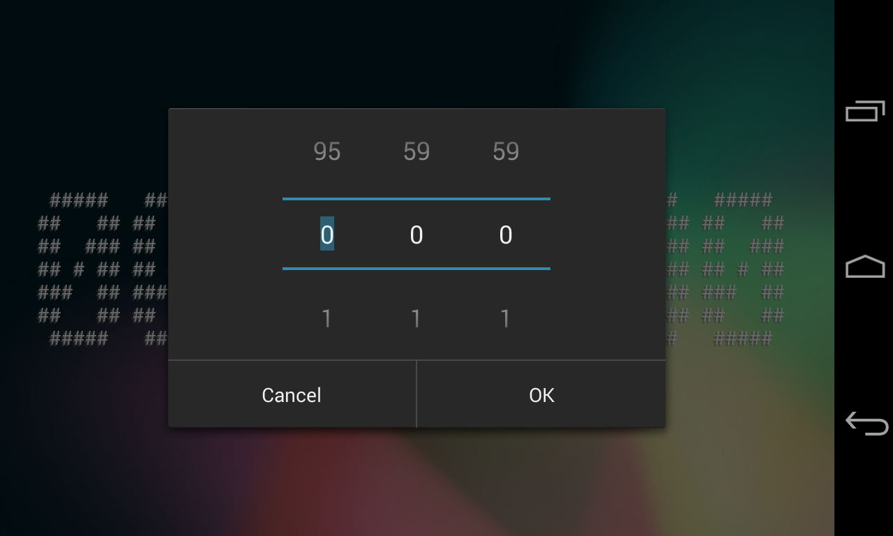
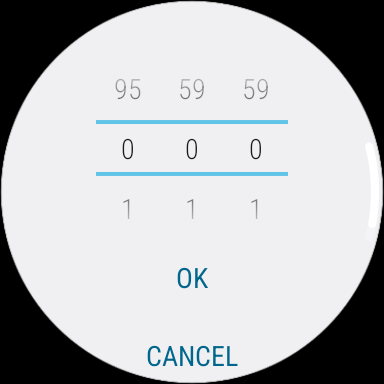

# Pomodoro

This is a very simple and tiny pomodoro timer application supporting Android 2.3 and later, with support for WearOS devices too!

## Features
- Countdown & countup timer (up to 96 hours)
- Cyan flashing reminder when each pomodori completed
- Normal texts or text arts display

## Controls
- **Single tap**: Dismiss reminder
- **Double tap**: Switch between texts or text arts display
- **Long tap**: Set a new timer

## Screenshots

 

## Forum posts
[XDA Developers](https://xdaforums.com/t/app-2-3-pomodoro-timer-app.4719016/)
